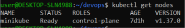
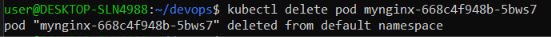
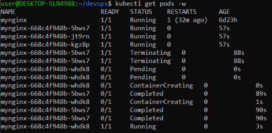
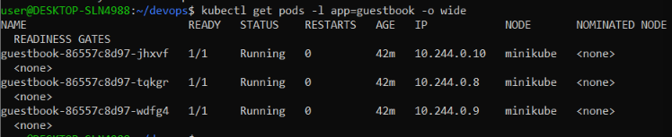
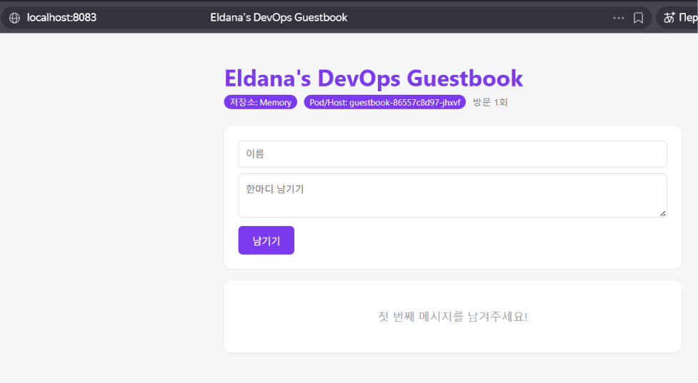

# Week 09 — Kubernetes 첫 배포 및 실습

## 1. 실습 개요 (Overview)

이번 실습에서는 Kubernetes의 기본 개념을 이해하고, Minikube를 사용하여 로컬 Kubernetes 클러스터를 구성하였다.

Kubernetes 클러스터의 상태를 확인하고, Deployment를 이용한 애플리케이션 관리 및 Pod Self-Healing 기능을 실습하였다. 또한 이전 주차에서 제작한 Guestbook 애플리케이션을 Kubernetes 환경에 배포하고 브라우저에서 실행 결과를 확인하였다.

### 실습 목표

- Minikube를 사용하여 로컬 Kubernetes 클러스터 실행하기
- `kubectl` 명령어를 사용하여 클러스터와 리소스 상태 확인하기
- Deployment를 이용하여 애플리케이션 관리하기
- Pod Self-Healing 동작 확인하기
- Guestbook 애플리케이션을 Kubernetes 환경에서 실행하기
- Declarative Configuration의 개념 이해하기

## 2. 실습 환경 (Environment)

| 항목                | 사용 기술                            |
| ----------------- | -------------------------------- |
| Operating System  | Windows + WSL2 (Ubuntu)          |
| Container Runtime | Docker                           |
| Kubernetes Tool   | Minikube                         |
| Kubernetes CLI    | kubectl                          |
| Application       | Guestbook                        |
| Image Registry    | GitHub Container Registry (GHCR) |

Minikube를 Docker Driver와 함께 사용하여 로컬 Kubernetes 클러스터를 실행하였다.

```bash
minikube start --driver=docker
```

현재 Kubernetes Context가 Minikube인지 확인하였다.

```bash kubectl config current-context ```

## 3. Kubernetes 클러스터 확인 (Cluster Status)

먼저 Kubernetes 클러스터에 연결할 수 있는지 확인하기 위해 다음 명령어를 실행하였다.

```bash
kubectl get nodes
```

실행 결과에서 `minikube` 노드의 상태가 `Ready`로 표시되는 것을 확인하였다.

이는 Kubernetes 노드가 정상적으로 동작하고 있으며, 클러스터를 사용할 수 있는 상태임을 의미한다.


## 4. Pod Self-Healing 실습

Kubernetes의 주요 기능 중 하나인 Self-Healing을 확인하기 위해 Deployment를 사용하였다.

Deployment는 사용자가 지정한 원하는 Pod 개수를 유지하도록 관리한다.

실습 과정에서는 다음 작업을 수행하였다.

1. Deployment를 생성하여 애플리케이션을 실행하였다.
2. `kubectl get pods` 명령어로 실행 중인 Pod 목록을 확인하였다.
3. `kubectl get pods -w` 명령어를 사용하여 Pod 상태 변화를 실시간으로 관찰하였다.
4. 실행 중인 Pod 하나를 삭제하였다.
5. Kubernetes가 삭제된 Pod를 대체할 새로운 Pod를 생성하는 것을 확인하였다.

이 과정을 통해 Kubernetes가 Deployment에 설정된 원하는 상태를 유지하기 위해 Pod를 자동으로 다시 생성한다는 것을 확인하였다.


## 5. Guestbook 애플리케이션 배포

이전 주차에서 제작한 Guestbook 애플리케이션을 Kubernetes 환경에 배포하였다.

애플리케이션이 Kubernetes 클러스터에서 실행되고 있는지 확인하기 위해 Pod 목록을 조회하였다.

```bash
kubectl get pods
```

Pod의 실행 상태를 확인한 후 Port Forwarding을 사용하여 로컬 브라우저에서 애플리케이션에 접근하였다.

```bash
kubectl port-forward deployment/guestbook 8083:5000
```

이 명령어는 로컬 컴퓨터의 8083 포트를 Guestbook 애플리케이션의 5000 포트에 연결한다.

브라우저에서 다음 주소로 접속하여 애플리케이션이 정상적으로 표시되는지 확인하였다.

```text
http://localhost:8083
```

### 실행 결과

다음 스크린샷은 Kubernetes 환경에서 실행 중인 Guestbook Pod와 브라우저에서 확인한 애플리케이션 화면이다.


## 6. Declarative Configuration이란?

Declarative Configuration은 시스템이 어떤 상태가 되어야 하는지를 먼저 정의하고, Kubernetes가 해당 상태를 유지하도록 관리하는 방식이다.

예를 들어 Deployment에 Pod를 3개 실행하도록 설정하면, Pod가 삭제되더라도 Kubernetes는 원하는 개수인 3개를 유지하기 위해 새로운 Pod를 생성한다.

이번 실습의 Self-Healing 과정은 Declarative Configuration의 개념을 이해하는 데 도움이 되었다.

## 7. 문제 상황 및 해결 방법 (Troubleshooting)

실습 중 Minikube 클러스터가 중지된 상태인 것을 확인하였다.

문제를 해결하기 위해 다음 명령어를 실행하여 클러스터를 다시 시작하였다.

```bash
minikube start --driver=docker
```

이후 `kubectl get nodes` 명령어를 실행하여 노드 상태가 `Ready`로 변경된 것을 확인하였다.

## 8. 실습 결과 및 느낀 점 (Conclusion)

이번 실습을 통해 Kubernetes의 기본적인 구조와 동작 방식을 이해할 수 있었다.

특히 Deployment를 사용하면 애플리케이션의 원하는 실행 상태를 유지할 수 있으며, Pod가 삭제되었을 때 Kubernetes가 자동으로 새로운 Pod를 생성한다는 점을 직접 확인하였다.

또한 Minikube를 이용하면 별도의 클라우드 Kubernetes 환경 없이도 로컬 컴퓨터에서 Kubernetes의 주요 기능을 학습할 수 있다는 것을 알게 되었다.

이번 실습은 Docker 기반 컨테이너 실행에서 한 단계 더 나아가 Kubernetes를 이용한 컨테이너 오케스트레이션을 경험하는 기회가 되었다.










