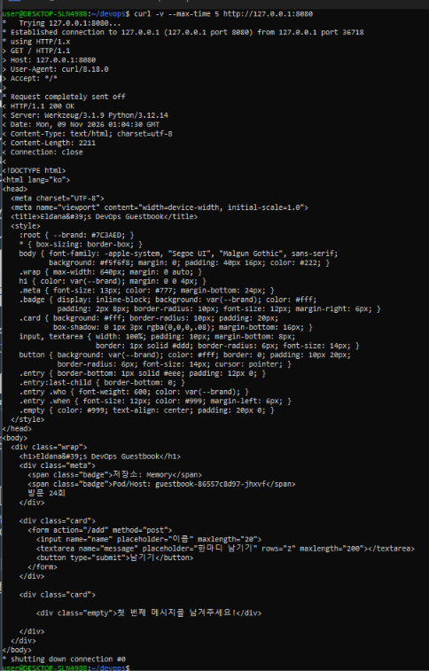
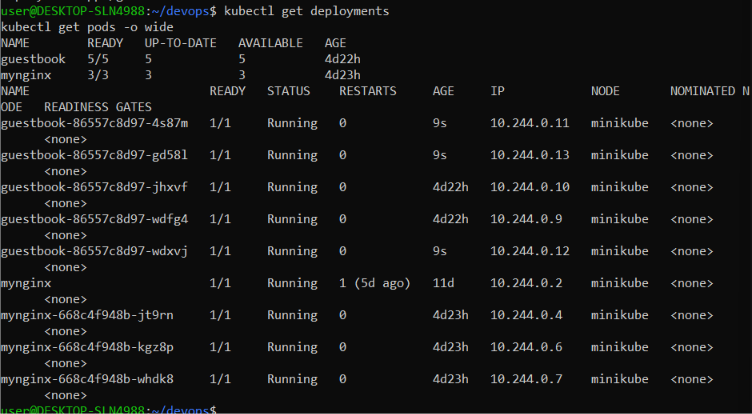
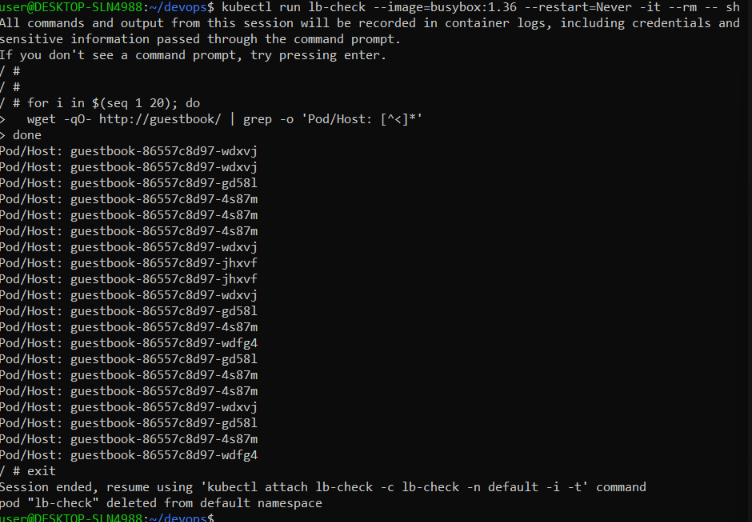
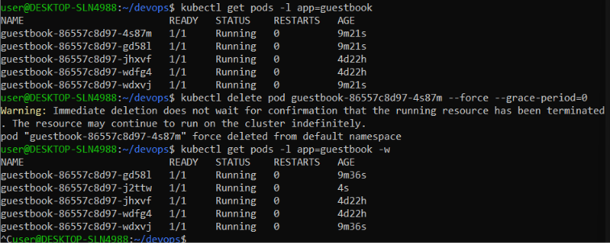
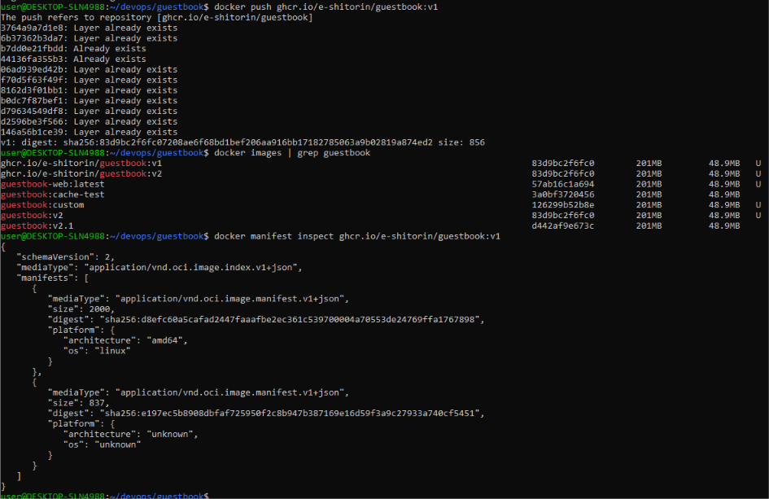
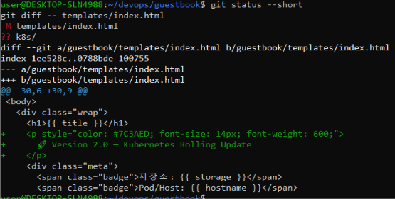
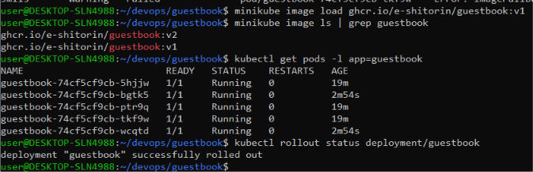
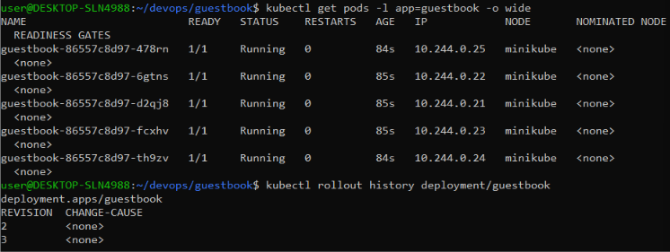
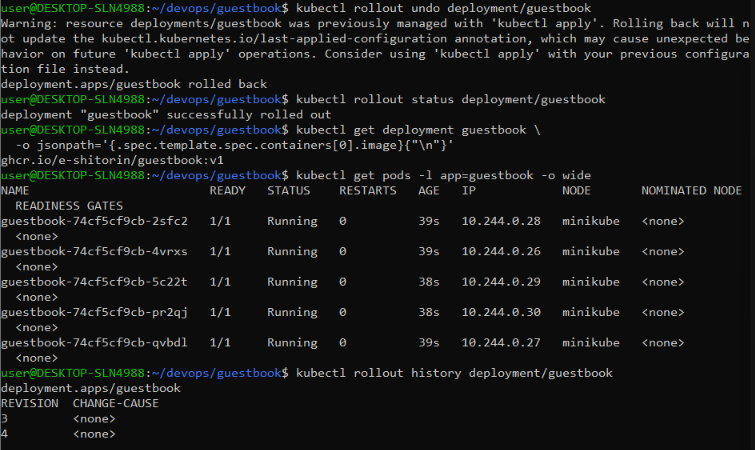

# Week 10 — Kubernetes 배포와 서비스

## 1. 실습 개요

이번 실습에서는 Kubernetes의 Deployment와 Service를 사용하여 애플리케이션의 확장, 트래픽 분산, 자동 복구, Rolling Update 및 Rollback 기능을 확인하였다.

실습 환경은 Minikube이며, Guestbook Flask 애플리케이션을 사용하였다.

## 2. 실습 환경

- Kubernetes: Minikube
- Container Runtime: Docker
- Application: Guestbook (Flask)
- Container Registry: GitHub Container Registry (GHCR)
- Deployment Name: `guestbook`
- Service Name: `guestbook`
- Service Type: NodePort
- Service Port: 80
- Container Port: 5000
- NodePort: 30080

## 3. Service 접근 확인

Guestbook 애플리케이션에 접근할 수 있도록 NodePort 타입의 Service를 생성하였다.

Service를 통해 애플리케이션에 HTTP 요청을 전송하고, HTTP 200 OK 응답을 확인하였다.



## 4. Deployment Scaling

Deployment의 Replica 수를 5개로 확장하였다.

```bash
kubectl scale deployment/guestbook --replicas=5
kubectl get pods -l app=guestbook
```

확인 결과, Guestbook Pod 5개가 정상적으로 실행되었다.



## 5. Service 및 Load Balancing

Service는 `app: guestbook` 라벨을 가진 Pod를 선택하며, Service의 80번 포트에서 컨테이너의 5000번 포트로 트래픽을 전달한다.

클러스터 내부에서 BusyBox 임시 Pod를 사용하여 여러 번 요청을 전송하였다. 요청 결과 서로 다른 Pod의 hostname이 확인되어 Service의 트래픽 분산 기능을 검증하였다.



## 6. Self-Healing

실행 중인 Guestbook Pod 하나를 직접 삭제하였다.

Deployment Controller가 삭제된 Pod를 자동으로 감지하고 새로운 Pod를 생성하는 것을 확인하였다.

이를 통해 Kubernetes의 Self-Healing 기능을 검증하였다.



## 7. Docker Image 및 GHCR

기존 Guestbook 이미지를 `v1` 태그로 게시하고, 변경된 애플리케이션 이미지를 `v2` 태그로 빌드하여 GHCR에 게시하였다.

- `v1`: 기존 애플리케이션 버전
- `v2`: 버전 표시 문구가 추가된 애플리케이션 버전



## 8. Rolling Update

애플리케이션의 HTML 템플릿에 버전 표시 문구를 추가하여 v2 이미지를 준비하였다.



다음 명령어를 사용하여 Deployment의 이미지를 v1에서 v2로 업데이트하였다.

```
kubectl set image deployment/guestbook guestbook=ghcr.io/e-shitorin/guestbook:v2
kubectl rollout status deployment/guestbook
kubectl rollout history deployment/guestbook
```

Rolling Update가 정상적으로 완료된 것을 확인하였다.





## 9. Rollback

Rolling Update 이후 다음 명령어를 사용하여 이전 버전으로 Rollback을 수행하였다.

```
kubectl rollout undo deployment/guestbook
kubectl rollout status deployment/guestbook
```

확인 결과, Deployment의 이미지가 v1으로 복구되었으며 Pod 5개가 모두 정상적으로 실행되었다.



## 10. Kubernetes 설정 파일

Kubernetes 설정 파일은 `guestbook/k8s/` 디렉터리에 저장하였다.

- `deployment.yaml`: Guestbook Deployment 설정 파일
- `service.yaml`: NodePort Service 설정 파일

최종 Deployment 설정은 Replica 5개와 이미지 v1을 사용한다.

## 11. 결론

이번 실습을 통해 Kubernetes의 주요 기능을 직접 확인하였다.

1. Deployment의 Replica 수 확장
2. Service를 통한 트래픽 분산
3. Pod 삭제 후 자동 복구
4. Rolling Update를 통한 애플리케이션 버전 업데이트
5. Rollback을 통한 이전 버전 복구

이를 통해 Kubernetes가 애플리케이션의 안정적인 배포와 운영을 지원하는 방법을 이해할 수 있었다.
